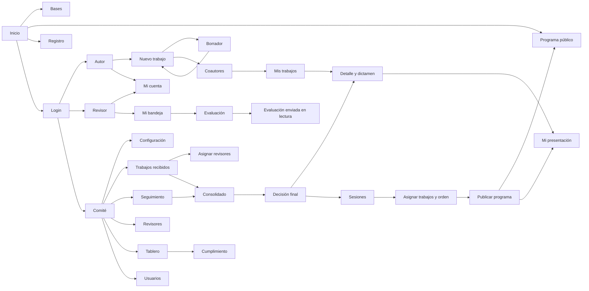

# Mapa de navegación del congreso

Referencia: página 4 de `Tema6_Mockups_f.pdf`. Las rutas se registran únicamente en `src/app/router.jsx`. El acceso por rol usa la sesión local de demostración.

| Área | Rutas |
| --- | --- |
| Visitante | `/`, `/bases`, `/programa-publico`, `/registro`, `/iniciar-sesion`, `/recuperar-contrasena` |
| Autor | `/autor`, `/autor/nuevo-trabajo`, `/autor/nuevo-trabajo/coautores?borrador=CODIGO`, `/autor/trabajos`, `/autor/trabajos/CODIGO`, `/autor/trabajos/CODIGO/lectura`, `/autor/presentacion?trabajo=CODIGO`, `/autor/cuenta` |
| Revisor | `/mi-cuenta`, `/bandeja-revision`, `/evaluacion/CODIGO` |
| Configuración | `/configuracion`, `/configuracion/ejes-tematicos`, `/configuracion/tipos-trabajo`, `/configuracion/fechas`, `/configuracion/criterios` |
| Comité | `/trabajos-recibidos`, `/trabajos-recibidos/CODIGO/consolidado`, `/trabajos-recibidos/CODIGO/decision`, `/revisores`, `/seguimiento`, `/programa`, `/programa/asignar-trabajos?sesion=ID`, `/tablero`, `/tablero/cumplimiento`, `/usuarios` |
| Ayuda y legales | `/guia-autores`, `/guia-revisores`, `/preguntas-frecuentes`, `/terminos`, `/privacidad` |

## Condiciones de los recorridos

- Coautores requiere un borrador propio. Volver a datos generales conserva su código.
- Enviar exige recepción abierta y plazo vigente. Cerrar recepción bloquea altas y edición de borradores.
- Evaluar requiere una asignación de la cuenta activa. Enviar la evaluación la deja en modo lectura.
- El consolidado reúne únicamente las evaluaciones de los revisores asignados al trabajo.
- Publicar una decisión actualiza el dictamen del autor y los trabajos aceptados disponibles para el programa.
- Publicar el programa requiere resolver solapamientos; conserva una instantánea pública de sesiones y orden.
- Mi presentación requiere un trabajo propio aceptado y una sesión publicada. Sin asignación se presenta un estado vacío con retorno.
- Los destinos de Programa del pie y del 404 llevan al programa público. `/mi-presentacion` redirige a la entrada protegida del autor.
- La recuperación 1.4 conserva su ampliación de código local de demostración (pantalla 12).

## Datos compartidos

Trabajos, coautores, asignaciones, evaluaciones, decisiones, sesiones, orden de exposición, publicación, cuentas y configuración se recuperan de los repositorios de `core/utils`. Las listas y métricas se calculan a partir de estos registros. Los recordatorios se registran localmente y no envían correo.

La referencia visual se valida en escritorio a **1920 × 1080**. En anchos menores solo se conserva la usabilidad y se evitan desbordamientos; no se define un mockup móvil adicional.
